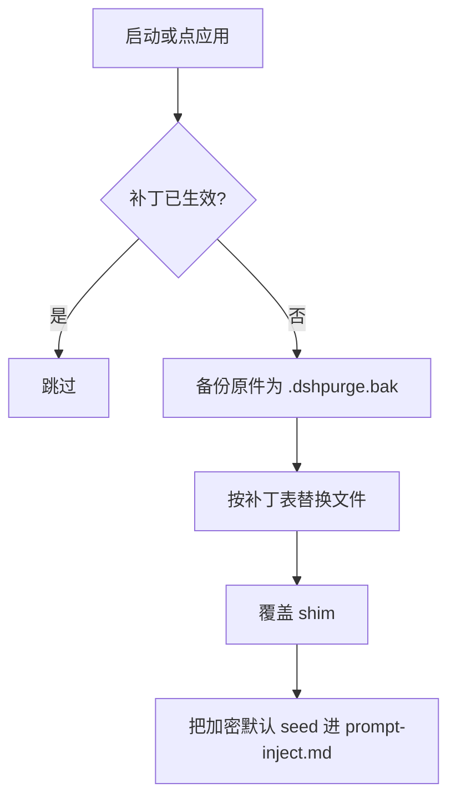
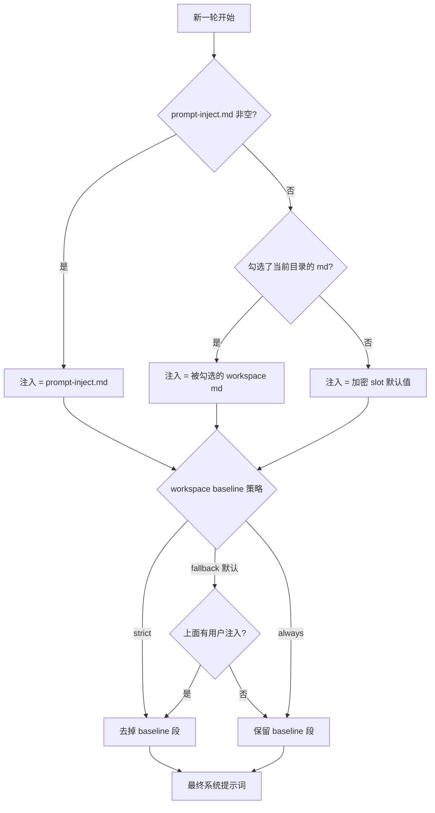

<p align="center">
  
</p>

<h1 align="center">dsh-purge</h1>

<p align="center">
  <strong>1.1.73</strong> · 自维护 fork <a href="https://github.com/37-oss/dsh-purge">37-oss/dsh-purge</a> · 上游 <a href="https://github.com/YuJunZhiXue/dsh-purge">YuJunZhiXue/dsh-purge</a>
</p>

<p align="center">
  
  
  =18">
  
</p>

---

装在本机官方 DeepSeek Harness 上的红队评测插件。它把「宿主拦住了」和「模型不答」拆开：提示词层、代码层、引擎层、工具层分别打补丁，**86 条补丁逐条可查状态、可单条还原**。

- 补丁表打在 `@deepseek-ai/*` 的本地文件上，原文对不上就跳过，不乱改。
- 默认提示词加密存在 `lib/asset-table.js`，运行期解出来注入，不读磁盘上的明文。
- 侧栏两页：**清洗**（补丁 / 提示词 / 规则集 / Skill / 自己的服务器）和 **演练台**（资产 / 技能 / 报告）。

## 目录

- [现在这个仓库](#现在这个仓库)
- [装](#装)
- [装完三步](#装完三步)
- [它到底改了什么](#它到底改了什么)
- [面板](#面板)
- [命令](#命令)
- [运行时文件](#运行时文件)
- [工作原理](#工作原理)
- [还原与卸载](#还原与卸载)
- [适配范围](#适配范围)
- [开发与校验](#开发与校验)
- [目录结构](#目录结构)
- [来源、署名与许可](#来源署名与许可)

---

## 现在这个仓库

| 项 | 值 |
| --- | --- |
| 版本 | `1.1.73`（`package.json`） |
| 分支 | `master` 发版线；`dev` 日常改动，CI 绿了再合 |
| 适配基线 | `dshTarget: 0.2.0-rc.2`，peer `@deepseek-ai/cordis ^4.0.1`，Node ≥18 |
| 补丁 | 86 条，id 1–92（有跳号，不复用） |
| CI | `verify`（node 20 / 22）+ `install-spec`（真装一次本仓库）+ `container`（干净容器） |
| 测试 | `tests/` 14 条 `node:test` 断言，零依赖 |

跟上游 1.1.71 的关系：**补丁表、默认提示词、演练台逻辑一行没改**。改的只是安装/更新地址指向本仓库，外加测试、CI、容器校验和几支维护脚本。

---

## 装

`dsh plugin add` 认 git 地址，直接指仓库：

```sh
# Web（官方 dsh web）
dsh plugin --profile web add github:37-oss/dsh-purge

# 桌面端（官方 EXE）
dsh plugin --profile desktop add github:37-oss/dsh-purge
```

要钉住版本，挂 `#` 后面：

| 想装 | 写法 |
| --- | --- |
| master 最新 | `github:37-oss/dsh-purge` |
| dev 分支 | `github:37-oss/dsh-purge#dev` |
| 某个提交 | `github:37-oss/dsh-purge#<sha>` |
| 某个 tag | `github:37-oss/dsh-purge#v1.1.73` |
| Release 源码包 | `https://github.com/37-oss/dsh-purge/releases/download/v1.1.73/dsh-purge-1.1.73.tar.gz` |
| 本机已 clone 的目录 | `dsh plugin --profile web add "C:\\Users\\35140\\Desktop\\dsh-work\\破甲\\dsh-purge"` |

几条边界：

- **`dsh plugin add dsh-purge` 不行**。裸包名走 npm registry，npm 上没有这个包名。
- 要 `git` 在 PATH 里：dsh 装 git 依赖前会先 `git ls-remote` 探一次仓库，连不上会把 git 的日志甩给你。
- 只有 `.tgz` / `.tar.gz` 能当 tarball 装，`.zip` 会被拒（`a URL must point at a git repository or a tarball`）。
- pnpm 会缓存 git 依赖。要强制换到最新提交：用 `#<sha>`，或 `dsh plugin --profile web update dsh-purge`。
- `dsh` 不在 PATH、或想手动塞进 profile：见 [手动安装](#手动安装)。

### 手动安装

<details>
<summary><strong>完整步骤</strong></summary>

**1. 找到真正在用的 `$DSH_HOME`**：名字是 `.dsh`（官方 EXE 偶见 `dsh-home`），里面有 `profiles`，且 `profiles/<名>/package.json` 的 `"name"` 是 `dsh-profile-web` 或 `dsh-profile-desktop`。查找顺序：`DSH_HOME` → 安装根旁的 `.dsh` → `%USERPROFILE%\.dsh` / `~/.dsh` → `%APPDATA%\DeepSeek Harness\dsh-home`。本机常有两份，用你**实际启动**的那个。

```powershell
$cands = @()
if ($env:DSH_HOME) { $cands += $env:DSH_HOME }
$cands += "$env:USERPROFILE\.dsh"
$dsh = Get-Command dsh -ErrorAction SilentlyContinue
if ($dsh) { $cands += @((Join-Path (Split-Path $dsh.Source) ".dsh")) }
$cands += @("$env:APPDATA\DeepSeek Harness\dsh-home", "$env:LOCALAPPDATA\DeepSeek Harness\dsh-home")
$cands | Select-Object -Unique | Where-Object { $_ -and (Test-Path (Join-Path $_ "profiles")) }
```

**2. 放到 `$DSH_HOME/plugins/dsh-purge`**（目录名必须是 `dsh-purge`，其 `package.json` 的 `"name"` 也必须是 `dsh-purge`）。

```sh
git clone https://github.com/37-oss/dsh-purge.git "$DSH_HOME/plugins/dsh-purge"
```

**3. 改对应 profile 的 `package.json`（先备份）**，只追加两处，其余依赖和 bundle 全留着：

1. `dependencies` 加 `"dsh-purge": "file:../../plugins/dsh-purge"`
2. `dsh.profile.bundles` 末尾加 `"dsh-purge"`

```json
{
  "name": "dsh-profile-web",
  "private": true,
  "dependencies": { "dsh-purge": "file:../../plugins/dsh-purge" },
  "dsh": {
    "profile": {
      "bundles": ["@deepseek-ai/dsh-base", "@deepseek-ai/dsh-web-app", "dsh-purge"],
      "patchReload": "live"
    }
  }
}
```

**4. 在那个 profile 目录里装依赖**（`cd` 进 profile，不要在仓库根）：

```sh
cd "$DSH_HOME/profiles/web"   # 或 profiles/desktop
pnpm install
```

成功标志：`profiles/<web|desktop>/node_modules/dsh-purge/package.json` 存在。

**5. 完全退出宿主 → 重开 → 点「应用」。**

</details>

---

## 装完三步

写进 profile **不会**自动改 `@deepseek-ai`。

1. 完全退出并重开刚装的那个宿主：Web 关掉 `dsh web` 再开；桌面端退出托盘再打开 EXE。
2. 在**这个宿主**点会话标题旁的 **dsh-purge** → **清洗** → **应用**。宿主的设置页里没有这个条目。
3. 应用成功会自动重启一次；没打完不重启。重启后**新开一轮对话**，注入才进当前会话。

Web 的控件只动 Web，桌面端只动桌面。怎样算装上了：按钮在、`/purge status` 能打出 `DSH_HOME` 和补丁列表、没装的可选包显示跳过但不挡应用完成。

---

## 它到底改了什么

补丁分四层注册在 `lib/core.js`，合并成 `ALL_PATCHES`：

| 层 | 条数 | 管什么 |
| --- | --- | --- |
| 提示词 | 25 | 免责声明、workspace baseline、审批话术、挂全文等文案替换 |
| 代码 | 50 | 审批门、沙箱策略、命令超时、队列 steer、子代理角色、会话注入路径 |
| 工具 | 8 | 工具描述与参数默认值 |
| 0.1.5 / 0.2.0 兼容 | 3 | 老版本与新版本各自的原文字符串 |

打得最多的目标包（前几名）：`agent-loop` 6、`desktop-shell` 5、`preset-minimal`+`preset-sdk-minimal` 4、`escalation` 4、`agent-instructions` 3、`base` 3、`pi-ai-anthropic-messages` 3。

每条补丁长这样，`pattern` 抄的是官方文件里的原文：

```js
{
  id: 93, name: "XXX_MARKER",
  layer: "代码", layer_en: "Code",
  desc: "清洗页显示的一句话",
  file: "agent-instructions", rel: ["lib", "index.js"],
  skipIfMarked: true,
  markers: ["[dsh-purge-93] xxx"],   // 幂等靠它：已写过就跳过
  replacements: [{ pattern: "官方原文", replace: "替换后的内容" }],
}
```

官方升版改了那一行字 → 这条打不中 → 状态转 `pending`（清洗页显示 ✗），**不会写坏文件**。要修就补一条「旧值 → 新值」的 replacement，保留原 pattern 当升级链。

---

## 面板

会话标题旁的 **dsh-purge** 打开右侧栏，白 / 墨可切。

| 区域 | 说明 |
| --- | --- |
| 清洗 | 补丁按组展开、应用 / 还原 / 卸载；编辑注入提示词；规则集；Skill 导入；自己的服务器 |
| 演练台 | 授权后的资产、技能与环境页；未授权时按钮标「未授权」，首次进入要读声明、滚到文末、勾三项 |
| 正式版 / 测试版 | 补丁标题下的通道切换：正式版跟 `master`，测试版跟 `beta` 分支 |

**自己的服务器**：中国大陆、香港、澳门地址默认禁止，只有事先登记的那一台例外。每行一台，写在 `$DSH_HOME/net-scope-allow.txt`：

- `203.0.113.10` —— 一个 IP
- `my-vps.example.com` —— 完整主机名（保存时解析出的地址也放行）
- `alice@my-vps.example.com` —— 账号只是备注，不证明归属

密钥、密码、网段、通配符保存时丢掉；对话里说「这是我的服务器」不放行。


---

## 命令

```sh
# CLI
dsh-purge --status       # 只读：宿主路径、补丁进度、shim 状态
dsh-purge --apply        # 应用全部清洗（唯一会写宿主文件的动作）
dsh-purge --revert       # 用 .dshpurge.bak 还原
dsh-purge --uninstall    # 先还原，再删插件
dsh-purge --edit         # 编辑 prompt-inject.md
dsh-purge --help

# 聊天
/purge status | apply | revert | uninstall | edit | help
/rules list | use <id> | create <id> | delete <id> | reset | help
/skills list | import <包或文件夹> | create <id> [说明] | delete <id> | help
/rewind

# 模型工具
purge_status   purge_apply   purge_revert
```

输入框旁的「回退一次」「回退上一轮」跟官方 `session.fork({ atSeq })`：撤回已进行的这一轮，新会话接上之前的上下文，旧会话归档。

---

## 运行时文件

全在 `$DSH_HOME`（未设时优先用 dsh 安装目录旁的 `.dsh`，再退回 `~/.dsh`；Web 和桌面端各用各的）：

| 路径 | 谁写的 | 说明 |
| --- | --- | --- |
| `prompt-inject.md` | 你 / 应用时 seed | 会话覆盖段。**用户文件**，还原和卸载都不删 |
| `rules/` | 面板「规则集」 | 多套 `AGENTS.md` / `CLAUDE.md` |
| `skills/` | 面板 / `/skills import` | 铺到官方目录，由 DSH 加载；不进注入段 |
| `net-scope-allow.txt` | 面板「自己的服务器」 | 放行名单 |
| `redteam/` | 演练台 | 资产库（SQLite）、报告 |
| `dsh-purge/channel.json` | 更新器 | 通道与钉选版本 |
| `dsh-purge/version-history.json` | 更新器 | 装过哪些版本 |

---

## 工作原理

**应用（启动时或点「应用」）**



**每一轮注入什么**



**幂等**：带 `skipIfMarked` 的补丁靠 `markers` 认自己写过的痕迹，重复应用不会叠层。

**路径探测**：先判 web / desktop，再按 `DSH_HOME` / `DSH_BASE` → 启动器旁的 `.dsh` → `npm prefix -g` → 嵌套 `node_modules/@deepseek-ai` → `~/.dsh` 找。找不到就提示设 `DSH_BASE`，不改文件。

---

## 还原与卸载

- 应用前把每个目标文件备份成 `<文件>.dshpurge.bak`；还原时覆盖回去并删备份。
- 没备份时，只去掉 shim 里本插件写入的行。
- `prompt-inject.md` 是用户文件，**还原不删、卸载也保留**。
- 卸载 = 先还原，再删注入文件、规则库、插件本身，然后重启。

---

## 适配范围

| dsh | 用哪版 |
| --- | --- |
| 0.2.x（官方 `dsh web` / 桌面 EXE 0.2.0-rc.2、0.2.1-rc.2） | 本仓库 `master`（1.1.73） |
| 0.1.7 及更早 | 上游的对应旧 tag |

- 官方 Web 与官方桌面**分开装、分开点应用**；社区桌面端不维护。
- 官方升版后补丁打不中就显示 `pending` 或跳过，不会乱改。
- Node ≥18；Windows 下要无闪窗需 ≥22。

---

## 开发与校验

三档，都不需要碰你正在用的 dsh：

| 档 | 命令 | 管什么 |
| --- | --- | --- |
| 静态 + 结构 | `npm run verify` | `node --check` 六连 + 14 条断言：exports 路径、bundle 挂载、86 条补丁字段与幂等标记、提示词 slot 往返、`client.js` 嵌入标记、署名保留、版本一致、README 安装命令 |
| 隔离容器 | `pwsh docker/verify.ps1` | `node:22-slim` + `--network none` + 仓库只读挂载：入口能加载、CLI 可用、空环境 `--apply` 必须被拒 |
| 云端 | push 触发 [ci.yml](.github/workflows/ci.yml) | `verify`(20/22) + `install-spec`（pnpm 真装本仓库）+ `container` |

改这个仓库时最常用的三条：

```sh
npm run extract-prompt   # lib/asset-table.js → lib/default-prompt-inject.md（明文，不进库）
# 改明文
npm run embed-prompt     # 重新封装，重写 lib/asset-table.js
npm run build:client     # lib/redteam/client.js → client.js 里的演练台片段
```

完整说明（代码地图、六种改法、发版、上游同步、危险动作）见 [docs/maintenance.md](docs/maintenance.md)。

**本机别随手 `--apply`**：那是唯一会写 `@deepseek-ai/*` 的动作。真机验证放一次性容器或虚拟机。

---

## 目录结构

```
bin/dsh-purge.js        CLI 入口（--status/--apply/--revert/--uninstall/--edit）
lib/core.js             补丁表 + 应用/还原/探测（361KB，86 条补丁在这里）
lib/index.js            插件本体：注入段、四个聊天命令、三个模型工具（108KB）
lib/asset-table.js      加密的默认提示词（生成物，明文不进库）
lib/table-key.js        sealSlot / mixKey
lib/table-read.js       openSlot
lib/redteam/            演练台 17 个模块（store 是 SQLite）
lib/update.js           自更新（REPO 指向本仓库，stable=master / beta=beta）
client.js               侧栏 UI（501KB 生成物，源在 lib/redteam/client.js）
cordis.patch.yml        装插件时插给宿主的 bundle 条目
presets/redteam/        红队预设 + anchor-gate.mjs
skills/redteam/         随包技能 23 个
scripts/                embed-default-prompt / build-client / patch-client-dock / run-tests / extract-default-prompt
tests/                  14 条 node:test 断言
docker/                 隔离校验（Dockerfile + smoke.sh + verify.ps1）
docs/                   maintenance.md（维护手册）、截图、披露文件
```

---

## 来源、署名与许可

- **原作者**：小杨（[YuJunZhiXue](https://github.com/YuJunZhiXue)），上游仓库 [YuJunZhiXue/dsh-purge](https://github.com/YuJunZhiXue/dsh-purge)。补丁思路、默认提示词、演练台都是他的成果。
- **本仓库**：[37-oss/dsh-purge](https://github.com/37-oss/dsh-purge)，自维护 fork，基线 1.1.71。
- **署名**：使用本项目的名称、思路、代码或提示词，必须署名并标明来源仓库。
- **许可**：正本见 [LICENSE](LICENSE)，是**商业软件许可**，不是 MIT。个人装机自用、按文档做本机评测可以；再分发、出售、卖课、白标、公开源码需要上游作者的书面授权，联系见 [LICENSE-COMMERCIAL.md](LICENSE-COMMERCIAL.md)。
- **上游闭源安排**：上游 2026-10-27 起不再在 GitHub 发新版本。本 fork 不接管它的版本线，也不对外发布上游后续的闭源构建。

本项目只作用于使用者**本机已安装**的官方 Harness 与本机配置：不对外网目标发包，不是公网扫描器。后果自负。
