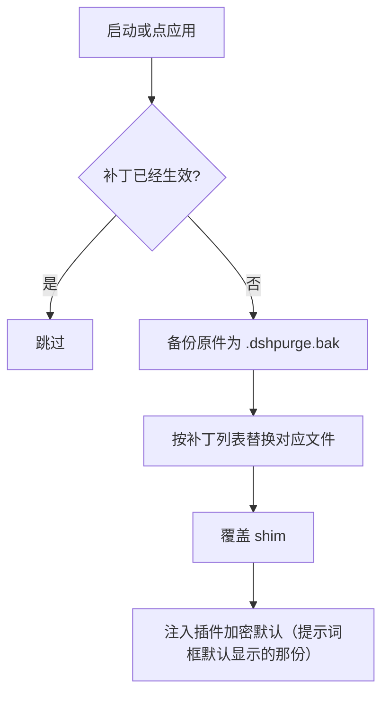
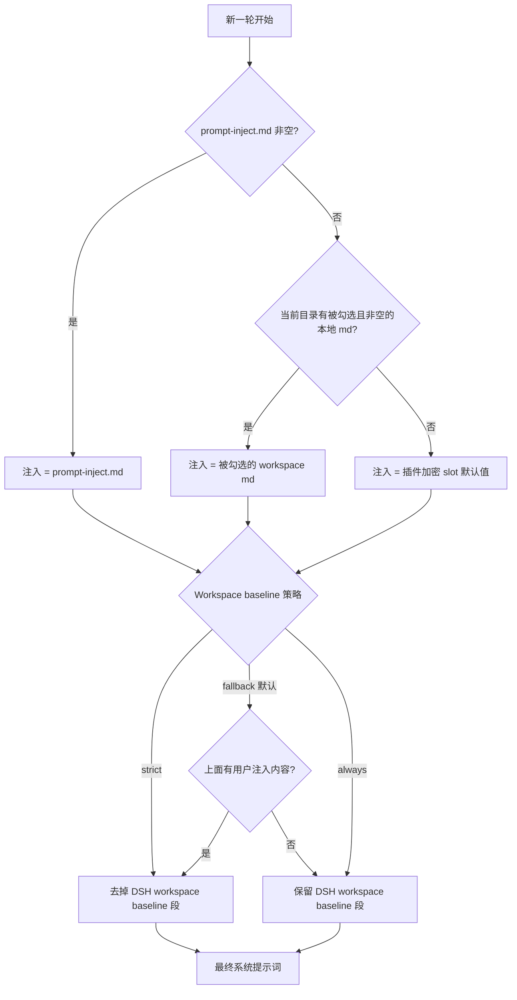

<p align="center">
  
</p>

<h1 align="center">dsh-purge</h1>

<p align="center">
  <strong>Version 1.1.72</strong> · 自维护 fork：<a href="https://github.com/37-oss/dsh-purge">37-oss/dsh-purge</a> · 上游：<a href="https://github.com/YuJunZhiXue/dsh-purge">YuJunZhiXue/dsh-purge</a>
</p>

<p align="center">
  
  
  
  
</p>

---

DeepSeek Harness 的破甲 / 红队评测插件。装在本机官方 Harness 上，把「宿主策略拦截」和「模型本身拒绝」拆开看：提示词层、审批门、沙箱、会话格式分别打补丁，逐条可查、可回滚。

这个仓库是**自维护 fork**（基线 = 上游 1.1.71）。上游作者是小杨（YuJunZhiXue），思路、补丁表和默认提示词都来自他；这里维护自己的版本线，改动只围绕「自己能装、能改、能验」。

- **默认提示词**面向国模「小码酱」，加密存在 `lib/asset-table.js`，可换成人话明文再封回去。
- **86 条补丁**覆盖提示词层、代码层、引擎层、新工具层，按组展示，逐条状态可查。
- **演练台**（资产 / 技能 / 报告）在侧栏第二页，首次进入要读声明、滚到底、勾三项。

## 目录

- [这个 fork 改了什么](#这个-fork-改了什么)
- [适配范围](#适配范围)
- [安装](#安装)
- [使用](#使用)
- [界面](#界面)
- [工作原理](#工作原理)
- [校验](#校验)
- [改这个仓库](#改这个仓库)
- [目录结构](#目录结构)
- [来源、署名与许可](#来源署名与许可)

---

## 这个 fork 改了什么

相对上游 1.1.71，只动身份指针和维护脚手架，**补丁表、默认提示词、演练台逻辑一行没改**。

| 项 | 改动 |
| --- | --- |
| 安装 / 更新地址 | `package.json` 的 `repository` / `homepage` / `bugs` / `dsh.install`，以及 `lib/update.js` 的 `REPO`，全部指向 `37-oss/dsh-purge`。「更新」按钮只拉本仓库的 tag |
| 版本线 | `1.1.72` 起自维护。自更新按 semver 比大小，不涨版本不会被更新 |
| 测试 | `tests/`：12 条 `node:test` 断言（exports 路径、bundle 挂载、补丁字段与幂等标记、提示词 slot 往返、`client.js` 嵌入标记、署名保留、版本一致） |
| CI | `.github/workflows/ci.yml`：node 20/22 矩阵 + 干净容器 job；`release.yml` 只在 `37-oss` 发版，发版前先跑全量校验 |
| 隔离校验 | `docker/`：容器里没 dsh、无网络、仓库只读挂载，`--apply` 必被拒。开发验证不碰本机安装 |
| 脚本 | `npm run extract-prompt`：从 `asset-table.js` 解出提示词明文以便编辑 |
| 文档 | [docs/维护手册.md](docs/维护手册.md)：代码地图、六种改法、发版、上游同步、危险动作清单 |

上游的赞助、广告位、商用公示那些版面没有搬过来；署名与许可照旧，见文末。

---

## 适配范围

只支持 **dsh 0.2**。官方 `dsh web` 用 profile `web`；官方桌面 EXE（**0.2.0-rc.2 / 0.2.1-rc.2**）用 profile `desktop`。两边分开装、分开点「应用」。社区桌面端不维护。

- dsh **0.2.x** → 本仓库 `master`（1.1.72）
- dsh **0.1.7** 及更早 → 上游的对应旧 tag

对不上的补丁显示待应用或跳过，不会乱改文件。

环境要求：Node.js **≥18**；Windows 下要无闪窗需 **≥22**。npm 上没有 `dsh-purge` 这个包名，安装走下面的归档地址，不要 `pnpm add dsh-purge`。

---

## 安装

**Web（官方 `dsh web`）**

```sh
dsh plugin --profile web add https://github.com/37-oss/dsh-purge/archive/refs/heads/master.tar.gz
```

**桌面端（官方 EXE）**

```sh
dsh plugin --profile desktop add https://github.com/37-oss/dsh-purge/archive/refs/heads/master.tar.gz
```

当前目录已经是本仓库时，把归档地址换成 `add .`。`dsh` 不在 PATH 时走下面的手动安装。

### 装完还要做三步

写进 profile **不会**自动改 `@deepseek-ai`。

1. 完全退出并重新打开刚装的那个宿主：Web 关掉 `dsh web` 再开；桌面端退出托盘再打开 EXE。
2. 在**这个宿主**里点会话标题旁的 **dsh-purge** → **清洗** → **应用**。宿主的设置页里没有这个条目。
3. 应用成功后会自动重启一次，让补丁进入当前进程；没打完不重启。重启后**新开一轮对话**，注入才进当前会话。

Web 的控件只动 Web，桌面端只动桌面。不要在一个宿主里点另一个宿主的「应用」。

**怎样算装上了**：会话标题旁有 dsh-purge 按钮；`/purge status` 能打出 `DSH_HOME` 和补丁列表；没装的可选包显示跳过，不挡应用完成。

### 手动安装

命令行装不上、或 `dsh` 不在 PATH 时用。只改**正在用的那个宿主**的 profile。

<details>
<summary><strong>完整手动步骤</strong></summary>

**1. 找到真正在用的 `$DSH_HOME`。** 名字是 `.dsh`（官方 EXE 偶见 `dsh-home`），里面有 `profiles`，且至少有一个 `profiles/<名>/package.json`。查找顺序：`DSH_HOME` 环境变量 → 安装根旁边的 `.dsh`（便携包）→ `%USERPROFILE%\.dsh` / `~/.dsh` → `%APPDATA%\DeepSeek Harness\dsh-home`。确认 `profiles/web/package.json` 里 `"name"` 是 `dsh-profile-web`（桌面是 `dsh-profile-desktop`）。本机常有两份 `.dsh`，用你**实际启动**的那个。

```powershell
$cands = @()
if ($env:DSH_HOME) { $cands += $env:DSH_HOME }
$cands += "$env:USERPROFILE\.dsh"
$dsh = Get-Command dsh -ErrorAction SilentlyContinue
if ($dsh) {
  $dir = Split-Path $dsh.Source
  $cands += @((Join-Path $dir ".dsh"), (Join-Path (Split-Path $dir) ".dsh"), (Join-Path (Split-Path (Split-Path $dir)) ".dsh"))
}
$cands += @("$env:APPDATA\DeepSeek Harness\dsh-home", "$env:LOCALAPPDATA\DeepSeek Harness\dsh-home")
$cands | Select-Object -Unique | Where-Object { $_ -and (Test-Path (Join-Path $_ "profiles")) }
```

**2. 把插件放到 `$DSH_HOME/plugins/dsh-purge`**（目录名必须是 `dsh-purge`，其 `package.json` 的 `"name"` 也必须是 `dsh-purge`）。

```sh
git clone https://github.com/37-oss/dsh-purge.git "$DSH_HOME/plugins/dsh-purge"
```

没有 git：下载 [master.tar.gz](https://github.com/37-oss/dsh-purge/archive/refs/heads/master.tar.gz)，解压后把 `dsh-purge-master` 改名 `dsh-purge`，整夹放进 `plugins`。

**3. 只改对应 profile 的 `package.json`，先备份。** Web → `$DSH_HOME/profiles/web/package.json`；桌面 → `profiles/desktop/package.json`。**只追加两处**，原有依赖和 bundle 全部保留：

1. `dependencies` 增加 `"dsh-purge": "file:../../plugins/dsh-purge"`
2. `dsh.profile.bundles` **末尾**追加 `"dsh-purge"`（已有就不要重复加）

```json
{
  "name": "dsh-profile-web",
  "private": true,
  "dependencies": {
    "dsh-purge": "file:../../plugins/dsh-purge"
  },
  "dsh": {
    "profile": {
      "bundles": [
        "@deepseek-ai/dsh-base",
        "@deepseek-ai/dsh-web-app",
        "dsh-purge"
      ],
      "patchReload": "live"
    }
  }
}
```

JSON 要合法；`file:../../plugins/dsh-purge` 不要改成绝对路径；`patchReload`、其它插件、版本号都不要动。桌面端没有 `dsh-web-app` 就不要硬加。

**4. 只在刚改的那个 profile 目录装依赖**（`cd` 进 profile 目录，不要在仓库根或 `$DSH_HOME` 根）：

```sh
cd "$DSH_HOME/profiles/web"   # 或 profiles/desktop
pnpm install
```

成功标志：`profiles/<web|desktop>/node_modules/dsh-purge/package.json` 存在。报 `Could not resolve` 就检查 `file:` 路径；JSON 解析失败就修逗号或还原备份。

**5. 完全退出该宿主，重新启动，再点「应用」。**

</details>

### 卸载

侧栏 **dsh-purge** → 清洗 → 卸载：先还原已应用的补丁，再重启宿主。命令行也可以：

```sh
dsh-purge --uninstall
# /purge uninstall
```

`prompt-inject.md` 是你自己的文件，卸载时保留。

---

## 使用

```sh
# CLI
dsh-purge --status       # 只读自检：宿主路径、补丁进度、shim 状态
dsh-purge --apply        # 应用全部清洗（唯一会写宿主文件的动作）
dsh-purge --revert       # 用 .dshpurge.bak 还原
dsh-purge --uninstall    # 先还原再删插件
dsh-purge --edit         # 编辑注入文件 prompt-inject.md

# 聊天
/purge status | apply | revert | uninstall | edit | help
/rules list | use <id> | create <id> | delete <id> | reset | help
/skills list | import <包或文件夹> | create <id> [说明] | delete <id> | help
/rewind

# 模型工具
purge_status   purge_apply   purge_revert
```

侧栏「清洗」里能做的事：分组看补丁并应用 / 还原 / 卸载；编辑注入提示词；管理多套规则集（`AGENTS.md` / `CLAUDE.md`）；导入 Skill；登记「自己的服务器」。

输入框旁的「回退一次」「回退上一轮」跟官方 `session.fork({ atSeq })`：撤回已进行的这一轮，新会话接上之前的上下文，旧会话归档。

### 自己的服务器

中国大陆、香港、澳门的地址默认禁止，只有事先登记的那一台例外。在「清洗」页提示词下面，每行一台：

- `203.0.113.10` —— 一个 IP
- `my-vps.example.com` —— 完整主机名（保存时解析出的地址也放行）
- `alice@my-vps.example.com` —— 账号只是备注，不能证明归属

点「保存名单」，写到 `$DSH_HOME/net-scope-allow.txt`。密钥、密码、网段、通配符在保存时丢掉；口头说「这是我的服务器」不放行。

---

## 界面

会话标题旁的 **dsh-purge** 打开右侧栏，两页：**清洗** 和 **演练台**。白 / 墨可切。

| 区域 | 说明 |
| --- | --- |
| 清洗 | 补丁、提示词、规则集、Skill、自己的服务器 |
| 演练台 | 授权后的资产、技能与环境页；未授权时按钮标「未授权」 |
| 补丁 | 分组查看状态，应用、还原或卸载；进度只计真正已应用的项 |

**清洗**


**演练台授权**（首次进入要读声明、等倒计时、滚到文末并勾三项）


**演练台**


**补丁**


**规则集**


---

## 工作原理

**应用（启动时或手动点「应用」）**



**每一轮的注入决策**



**还原规则**

- 每个目标文件在应用前备份为 `<文件>.dshpurge.bak`；还原时覆盖回去并删备份，没备份就去掉 shim 里本插件写入的行。
- `prompt-inject.md` 是用户文件，还原时保留。
- 卸载 = 先还原，再删注入文件、规则库和插件本身。
- 重复应用是幂等的（带 `skipIfMarked` 的补丁靠 `markers` 认自己写过的痕迹）。

**路径探测**：先判断 web / desktop，再按 `DSH_HOME` / `DSH_BASE` → 启动器旁的 `.dsh` → `npm prefix -g` → 嵌套 `node_modules/@deepseek-ai` → `~/.dsh` 依次找。找不到就提示设 `DSH_BASE`，不改文件。

---

## 校验

三档，都不需要碰你正在用的 dsh 安装：

| 档 | 命令 | 管什么 |
| --- | --- | --- |
| 静态 + 结构 | `npm run verify` | 语法（`node --check` 六连）、exports 路径、bundle 挂载、86 条补丁字段与幂等标记、提示词 slot 往返、`client.js` 嵌入标记、署名保留、版本一致 |
| 隔离容器 | `pwsh docker/verify.ps1` | `node:22-slim` + `--network none` + 仓库只读挂载；验入口能 import、CLI `--status`，并反向举证空环境下 `--apply` 被拒 |
| 云端 | push 触发 [ci.yml](.github/workflows/ci.yml) | node 20 / 22 矩阵 + 容器 job，每次 push / PR 自动跑 |

本机长期维护**不要**随手 `--apply`：那是唯一会写 `@deepseek-ai/*` 的动作。真机验证放在一次性容器或虚拟机里。

---

## 改这个仓库

完整说明见 [docs/维护手册.md](docs/维护手册.md)。三条最常用的：

**换默认提示词**

```sh
npm run extract-prompt      # lib/asset-table.js → lib/default-prompt-inject.md（明文，不进库）
# 改明文
npm run embed-prompt        # 重新封装，重写 lib/asset-table.js（每次随机 salt，diff 变是正常）
npm run verify
```

**加一条补丁**：`lib/core.js` 里 `PATCHES` / `CODE_PATCHES` / `ENGINE_PATCHES` / `NEW_TOOL_PATCHES` 追加对象。`id` 不复用；`skipIfMarked` 必须配 `markers`，否则每次 apply 叠一层；`pattern` 抄的是官方文件原文，官方升版改字就打不中，状态转 pending，不会写坏文件。

**改侧栏 UI**：只改 `lib/redteam/client.js`，然后 `npm run build:client` 重建 `client.js` 里 BEGIN/END 标记之间的片段。其余部分是给官方 bundle 打的补丁，别手改。

---

## 目录结构

```
bin/            命令行入口
lib/            补丁表（core.js）、插件本体（index.js）、加密提示词（asset-table.js）、演练台（redteam/）
presets/        红队预设
skills/         随包技能（22 个）
client.js       侧栏 UI（生成物，源在 lib/redteam/client.js）
cordis.patch.yml  装插件时给宿主加的 bundle 条目
tests/          结构断言（node:test）
docker/         隔离校验
docs/           维护手册与截图
```

运行时文件在 `$DSH_HOME`：`prompt-inject.md`、`rules/`、`skills/`、`net-scope-allow.txt`、`redteam/`。未设 `DSH_HOME` 时优先用 dsh 安装目录旁的 `.dsh`，再退回 `~/.dsh`。Web 和桌面端各用各的目录。Skill 不进注入段，也不顶替提示词。

---

## 来源、署名与许可

- **原作者**：小杨（[YuJunZhiXue](https://github.com/YuJunZhiXue)），上游仓库 [YuJunZhiXue/dsh-purge](https://github.com/YuJunZhiXue/dsh-purge)。补丁思路、默认提示词、演练台均为其成果。
- **本仓库**：[37-oss/dsh-purge](https://github.com/37-oss/dsh-purge)，自维护线，fork 自上游 `1.1.71`。
- **署名**：使用本项目的名称、思路、代码或提示词，必须署名并标明来源仓库。
- **许可**：正本见 [LICENSE](LICENSE)，是**商业软件许可**，不是 MIT。个人装机自用与按文档做本机评测可以；再分发、出售、卖课、白标、公开源码，需要上游作者的书面授权，联系方式见 [LICENSE-COMMERCIAL.md](LICENSE-COMMERCIAL.md)。
- **上游闭源安排**：上游 2026-10-27 起不再在 GitHub 发新版本。这个 fork 不接管上游的版本线，也不对外发布上游后续的闭源构建。

本项目只作用于使用者**本机已安装**的官方 Harness 与本机配置：不对外网目标发包，不做公网扫描器。使用者自行承担一切使用后果。
